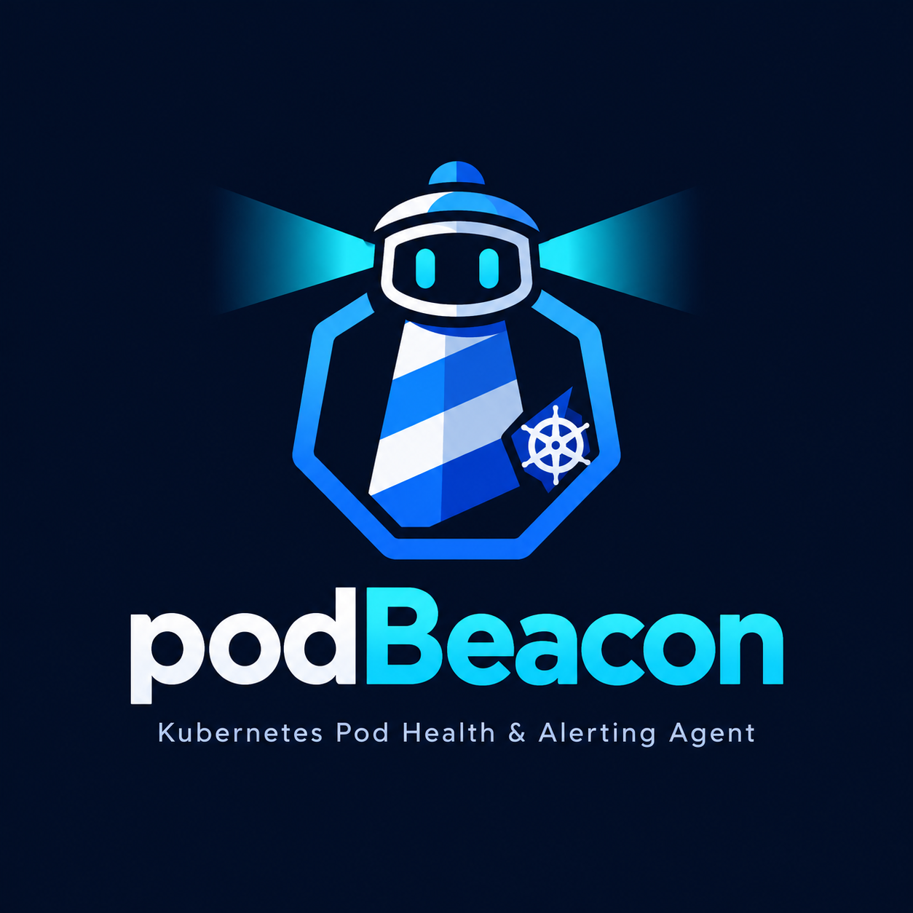

<p align="center">
  
</p>

A Go agent that finds unhealthy Pods, asks a model for a likely cause, and posts the hypothesis to a Slack channel. When that problem later clears, it posts whether the Pod recovered or is gone.

For now, Grok is the only model. ChatGPT and Claude are planned.

The scan talks only to the Kubernetes API. The model API is called only when a Pod is new enough to alert on.

## How it works

1. Every `POLL_INTERVAL` (default 1 minute) the process lists Pods. Outside a cluster it uses the default kubeconfig (`KUBECONFIG` or `~/.kube/config`). Inside a cluster it uses the ServiceAccount.
2. Classification is local. A healthy Pod, a `Succeeded` Pod, and a Pod that is being deleted stop here.
3. For each problem that has not been alerted yet, the agent reads that Pod's events and a log tail from the affected containers.
4. That report goes out in a single `POST /v1/responses` call (`XAI_MODEL`, default `grok-4.7`). There are no tools and no conversation continuation. The request sets `store: false`.
5. The answer becomes one Slack message: pod, a short reason (not the raw API error), the container image when it matters, and, when known, phase, node, and restart count, then a one-line likely cause and up to three checks. The message says the cause is a hypothesis.

Silence is kept in the process memory. Two replicas would send the same message. The Deployment in `deploy/podbeacon.yaml` uses one replica and the `Recreate` strategy.

### When the problem is gone

A later scan checks every Pod that already produced a card. If the Pod is still in the cluster and that problem is gone, podbeacon posts a short card that says the Pod was corrected. If the Pod is missing from the API, or Kubernetes is deleting it, the card says the Pod is gone. The card repeats the problem that was alerted. It does not call the model, and it does not count toward `MAX_ALERTS_PER_SCAN`.

```
*payments/api*
Resolved · CrashLoopBackOff · api
```

If Slack rejects the card, the next scan tries again. After the card is sent, the same problem can alert again immediately, including during `ALERT_COOLDOWN`. A restart forgets which cards are still open, so it does not send a closing card for alerts posted before the restart. A Pod that is still unhealthy, only with a different reason, stays open and gets a new problem card instead of a closing one.

### Credit fallback

When the xAI account is out of prepaid credits, or the invoiced spending limit has been reached, podbeacon still posts to Slack. That card names the pod and the problem, plus phase, node, and restart count when those are known. It does not include a likely cause, checks, or any other suggestion.

```
*payments/api*
CrashLoopBackOff · api
Running
```

The rest of that scan does not call the model. The next scan tries again, so adding credits resumes diagnosis without a process restart. Any other model failure still posts the problem with a note that the automatic analysis did not come back. If Slack itself fails, the pod is not silenced and the next scan retries.

### What counts as a problem

Alerted immediately:

- waiting on `CrashLoopBackOff`, `ImagePullBackOff`, `ErrImagePull`, `CreateContainerConfigError`, `CreateContainerError`, `InvalidImageName`, `RunContainerError`, or `DeadlineExceeded`
- a container terminated with `OOMKilled`, `Error`, `ContainerCannotRun`, `StartError`, or any other non-zero exit
- phase `Failed` or `Unknown`

`ErrImagePull` and `ImagePullBackOff` share the same silence key.

After `STARTUP_GRACE` (default 2 minutes):

- `ContainerCreating`, `PodInitializing`, or `CreateContainer`
- `Pending` and `Unschedulable`
- `Running` that is still `NotReady`

An init container that is still running does not raise `Pending`, so a long migration does not alert. A `Ready` container does not alert on an old OOM in its previous state. If it is in `CrashLoop` and the previous state was `OOMKilled`, both go into the report.

### What is sent to the model

Pod status, owner, `app` and `app.kubernetes.io/*` labels, conditions, up to 12 events, and logs from the problem containers (at most two). Each read asks for `LOG_TAIL_LINES` lines and at most `MAX_LOG_BYTES` bytes. The whole report is cut at 24,000 characters.

Before the call, passwords, Bearer tokens, JWTs, `AKIA` keys, and `xoxb-` / `xoxp-` tokens are masked. The name of a missing Secret, such as `secret "db" not found`, is kept.

The model is called only when the reason is outside `ALERT_COOLDOWN` and the alert fits in `MAX_ALERTS_PER_SCAN`. The most severe problems go first. A quiet cluster spends zero tokens.

## Environment variables

Durations use Go's format: `30s`, `1m`, `2h`. Integers must be positive. Booleans accept `1`, `true`, `yes`, `y`, `sim` and `0`, `false`, `no`, `n`, `nao`, `não`.

| Variable | Required | Default | Purpose |
| --- | --- | --- | --- |
| `XAI_API_KEY` | yes | | API key. Also required for `--dry-run`, because the model is still called. Create one at [console.x.ai](https://console.x.ai/team/default/api-keys). |
| `XAI_MODEL` | no | `grok-4.7` | Model for the call. |
| `XAI_BASE_URL` | no | `https://api.x.ai/v1` | Base URL. Must be `https`. |
| `XAI_TIMEOUT` | no | `180s` | Time limit for one model call. |
| `SLACK_WEBHOOK_URL` | one Slack mode | | Incoming webhook. Must be `https`. |
| `SLACK_BOT_TOKEN` | one Slack mode | | `xoxb-…` token for `chat.postMessage`. The bot must be in the channel. |
| `SLACK_CHANNEL` | with the bot token | | Channel ID, for example `C0123456789`. |
| `NAMESPACES` | no | all | Comma-separated list. Empty lists the whole cluster, minus the excluded namespaces. |
| `EXCLUDE_NAMESPACES` | no | `kube-system,kube-public,kube-node-lease` | Namespaces to skip. If the variable is set and empty, nothing is excluded. |
| `POLL_INTERVAL` | no | `1m` | Time between scans. |
| `ALERT_COOLDOWN` | no | `30m` | Silence for the same Pod and the same reason. A closing card clears it. |
| `STARTUP_GRACE` | no | `2m` | Wait before alerting on Pending, slow container creation, NotReady, and Unschedulable. |
| `LOG_TAIL_LINES` | no | `80` | Log lines requested per container. |
| `MAX_LOG_BYTES` | no | `12000` | Maximum bytes for each log read. |
| `MAX_ALERTS_PER_SCAN` | no | `8` | New alerts per scan. |
| `DRY_RUN` | no | `false` | Prints the message to stdout and does not call Slack. Slack variables may be empty in this mode. |
| `ONCE` | no | `false` | Runs one scan and exits. |

Set only one Slack destination: the webhook, or the token and channel pair. Setting both makes the process refuse the configuration. `DRY_RUN` or `--dry-run` may omit the destination.

The `--once` and `--dry-run` flags turn on the same behavior as `ONCE` and `DRY_RUN`. They do not turn off a value that came from the environment.

[`.env.example`](.env.example) lists the same keys.

## Run locally

```bash
cp .env.example .env
```

Fill in `XAI_API_KEY` and `SLACK_WEBHOOK_URL`. For a first test, limit the scope with `NAMESPACES`.

```bash
set -a && source .env && set +a
go run ./cmd/podbeacon --once --dry-run
```

Without `--dry-run`, the message goes to Slack. Without `--once`, the process loops until `SIGINT` or `SIGTERM`.

```bash
go test ./...
```

## Run in the cluster

The manifest creates the `podbeacon` namespace, the ServiceAccount, `get/list/watch` on pods and events, `get` on `pods/log`, and the Deployment. The image is `ghcr.io/nopp/k8s-agent-ai:1.0.5`, with `imagePullPolicy: IfNotPresent`. The `ghcr` secret lets the node pull that image.

Create a classic PAT with `read:packages`, or a fine-grained token that can read packages in this repository.

```bash
kubectl apply -f deploy/podbeacon.yaml
kubectl -n podbeacon create secret docker-registry ghcr \
  --docker-server=ghcr.io \
  --docker-username=nopp \
  --docker-password='<PAT with read:packages>'
kubectl -n podbeacon create secret generic podbeacon \
  --from-literal=XAI_API_KEY='...' \
  --from-literal=SLACK_WEBHOOK_URL='https://hooks.slack.com/services/...'
kubectl -n podbeacon rollout restart deployment/podbeacon
```

To publish another version, change the image tag in the Deployment and apply again. The workflow also publishes `:latest`, but the manifest uses the pinned version.

The `podbeacon` Secret is loaded with `envFrom`. The interval, grace period, cooldown, excluded namespaces, and alert cap are set on the Deployment and can be changed there.
